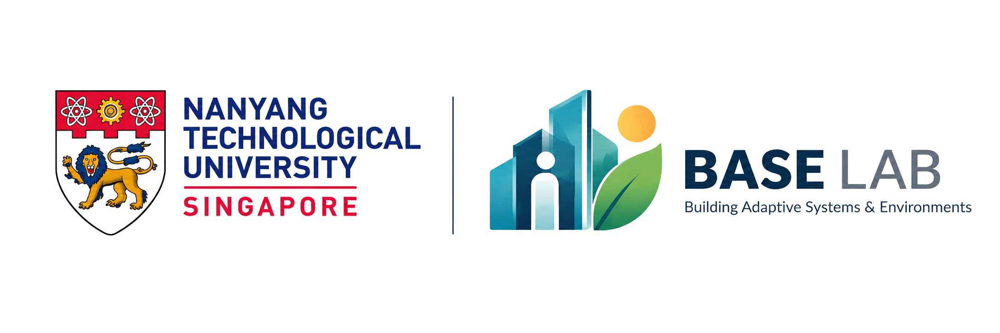

<link href="https://cdnjs.cloudflare.com/ajax/libs/font-awesome/5.15.4/css/all.min.css" rel="stylesheet">

<!-- ── Header ── -->

  

  
  

    <h1 style="font-size:2em; font-weight:800; color:#0d2244; margin:0 0 5px; line-height:1.15; border:none;">Join Us</h1>
    
BASE Lab @ NTU Singapore

  

<!-- ── Intro ── -->

  
<strong><a href="https://zeynepduygutekler.github.io/baselab/" target="_blank" style="color:#2a9d8f;">BASE Lab @ NTU Singapore</a></strong> welcomes motivated researchers interested in advancing AI-driven solutions for intelligent and sustainable built environments. We offer opportunities for PhD students, postdoctoral researchers, and visiting researchers to pursue impactful research, develop new ideas, and contribute to real-world applications.

  
Our team is also actively engaged in international research collaborations with leading researchers and institutions worldwide, including the University of Oxford and Loughborough University in the United Kingdom.

  
<strong>Explore our current openings and find the right opportunity for you below.</strong>

<!-- ══════════════════════════════
     FEATURED FUNDED POSITION
══════════════════════════════ -->

  
<i class="fas fa-star"></i>&nbsp; PhD + Postdoc Positions — Open Now

  <h3>Agentic AI &amp; Large Language Models for Intelligent Buildings</h3>
  
We are recruiting <strong>two PhD students and two postdoctoral researchers</strong> for a funded project developing a human-centric agentic AI system for next-generation building automation. The project integrates large language models (LLMs), multimodal sensing, and domain knowledge to enable buildings to learn occupant preferences, reason about environmental conditions, and adapt operations to enhance human comfort and energy efficiency. See the requirements below.

  

    <i class="fas fa-robot" style="margin-right:4px;"></i>Agentic AI Systems
    Large Language Models
    Multimodal Sensing
    Personalised Building Control
  

<!-- ══════════════════════════════
     OPEN POSITIONS
══════════════════════════════ -->

  

<h2>Open Positions</h2>

  <!-- PhD -->
  

    
<i class="fas fa-graduation-cap ju-acc-icon"></i>PhD StudentsActively Recruiting · Aug 2027<i class="fas fa-chevron-down ju-acc-arrow"></i>

    

      
Open to Singaporeans, Singapore PRs, and international students with a strong background in engineering, data science, built environment, or a related field. Actively recruiting for the <strong>August 2027 intake</strong>.

      

        
<i class="fas fa-university" style="color:#2a9d8f; margin-right:5px;"></i>NTU MAE PhD Programme

        
The primary route for PhD admission at NTU. Successful applicants are considered for the <a href="https://www.ntu.edu.sg/admissions/graduate/financialmatters/scholarships" target="_blank" style="color:#2a9d8f;font-weight:600;">NTU Research Scholarship (RSS)</a> — covering tuition and a monthly stipend.

        

          
How it works

          <ul style="margin:0; padding-left:16px;">
            <li style="font-size:0.82em; color:#444; margin-bottom:5px;">Contact me first — email your CV and a research statement. See <a href="#how-to-apply" style="color:#2a9d8f;font-weight:600;">How to Apply</a> below.</li>
            <li style="font-size:0.82em; color:#444; margin-bottom:5px;">Apply via the <a href="https://www.ntu.edu.sg/education/graduate-programme/mae-phd" target="_blank" style="color:#2a9d8f;font-weight:600;">NTU graduate admissions portal</a></li>
            <li style="font-size:0.82em; color:#444;">Shortlisted candidates will be invited for an interview</li>
          </ul>
        

        
Intake Deadlines

        <ul style="margin:0 0 8px; padding-left:17px;">
          <li style="font-size:0.82em; color:#444; margin-bottom:4px;">August 2027 Intake: deadline <strong>31 January</strong> (portal opens 1 Oct 2026)</li>
          <li style="font-size:0.82em; color:#444; margin-bottom:4px;">January 2028 Intake: deadline <strong>31 July</strong> (portal opens 1 Jun 2027)</li>
        </ul>
        
Before starting this process, please read through the <a href="https://www.ntu.edu.sg/admissions/graduate/radmissionguide?utm" target="_blank" style="color:#2a9d8f;font-weight:600;">NTU Graduate Admission Guidelines</a> carefully to understand the full process, eligibility, and document requirements.

        
<i class="fas fa-award" style="color:#2a9d8f; margin-right:5px;"></i>Other PhD Scholarships

        
The following scholarships are either <strong>NTU-awarded</strong> or <strong>externally funded</strong>, each requiring a separate application. All follow NTU's August or January intake cycles. Check each official website for current deadlines and eligibility — if interested, email me your CV indicating your intended scholarship.

        

          
<i class="fas fa-list" style="color:#2a9d8f;"></i> View scholarships <i class="fas fa-chevron-down ju-sub-arrow"></i>

          

            

              <table class="ju-scholar-table">
                <thead>
                  <tr>
                    <th>Scholarship</th>
                    <th>Eligibility</th>
                    <th>Typical Deadline</th>
                    <th>Details</th>
                  </tr>
                </thead>
                <tbody>
                  <tr><td colspan="4" class="ju-st-cat ext">NTU-AWARDED</td></tr>
                  <tr>
                    <td><a href="https://www.ntu.edu.sg/admissions/graduate/financialmatters/scholarships/npgs" target="_blank" class="ju-st-name">NPGS</a>Nanyang President's Graduate Scholarship</td>
                    <td>All nationalities</td>
                    <td>Nomination only (1 Nov – 31 Dec)</td>
                    <td>Full tuition, monthly stipend, and annual conference allowance. Outstanding academic record and research potential; Highest Distinction or equivalent.</td>
                  </tr>
                  <tr>
                    <td><a href="https://www.ntu.edu.sg/admissions/graduate/financialmatters/scholarships/pga" target="_blank" class="ju-st-name">PGA</a>Provost's Graduate Award</td>
                    <td>All nationalities</td>
                    <td>Nomination only (~1 Nov – 31 Dec)</td>
                    <td>Additional monthly allowance on top of RSS. Highest Distinction or equivalent; exceptional research potential.</td>
                  </tr>
                  <tr>
                    <td><a href="https://www.ntu.edu.sg/graduate-college/admissions/scholarships/yunqi-phd-scholarship-in-science-and-technology" target="_blank" class="ju-st-name">Yunqi PhD Scholarship</a>Science &amp; Technology</td>
                    <td>All nationalities</td>
                    <td>Aligns with NTU PhD intake deadlines (31 Jan for Aug; 31 Jul for Jan) — check <a href="https://www.ntu.edu.sg/graduate-college/admissions/scholarships/yunqi-phd-scholarship-in-science-and-technology" target="_blank" style="color:#2a9d8f;">NTU portal</a></td>
                    <td>Full tuition and monthly stipend for PhD candidates in science and technology at NTU.</td>
                  </tr>
                  <tr><td colspan="4" class="ju-st-cat ext">EXTERNALLY FUNDED</td></tr>
                  <tr>
                    <td><a href="https://aisingapore.org/research/phd-fellowship-programme/" target="_blank" class="ju-st-name">AISG PhD Fellowship</a>AI Singapore</td>
                    <td>All nationalities (SG/PR/ASEAN encouraged)</td>
                    <td>Annual (~Oct) — nomination by supervisor; check <a href="https://aisingapore.org/research/phd-fellowship-programme/" target="_blank" style="color:#2a9d8f;">AISG website</a></td>
                    <td>Full tuition, monthly stipend, and conference travel support. Focused on AI fundamental research. Nomination-based.</td>
                  </tr>
                  <tr>
                    <td><a href="https://www.a-star.edu.sg/scholarships/home/scholarships/ags--scholarship" target="_blank" class="ju-st-name">A*STAR Graduate Scholarship (AGS)</a>A*STAR</td>
                    <td>All nationalities</td>
                    <td>Round 1: 1 Nov–1 Feb &nbsp;|&nbsp; Round 2: 1 Jun–10 Aug</td>
                    <td>Full tuition, monthly stipend, and overseas research attachment support. International awardees commit to 3 years of work in Singapore post-graduation.</td>
                  </tr>
                  <tr>
                    <td><a href="https://www.a-star.edu.sg/Scholarships" target="_blank" class="ju-st-name">SINGA</a>Singapore International Graduate Award</td>
                    <td>International students</td>
                    <td>Annual (~Jun for Jan intake)</td>
                    <td>Full tuition, monthly stipend, and one-time airfare grant. Joint A*STAR–NTU PhD programme.</td>
                  </tr>
                  <tr>
                    <td><a href="https://www.psc.gov.sg/scholarships/postgraduate-scholarships/lee-kuan-yew-scholarship" target="_blank" class="ju-st-name">Lee Kuan Yew Scholarship</a>Public Service Commission</td>
                    <td>Singapore citizens only</td>
                    <td>Annual (~Jan–Mar) — check <a href="https://www.psc.gov.sg/scholarships/postgraduate-scholarships/lee-kuan-yew-scholarship" target="_blank" style="color:#2a9d8f;">PSC website</a></td>
                    <td>Full tuition and generous annual allowance for up to 5 years. Highly competitive; no bond requirement.</td>
                  </tr>
                  <tr>
                    <td><a href="https://www.ntu.edu.sg/admissions/graduate/financialmatters/scholarships" target="_blank" class="ju-st-name">EDB Industrial Postgraduate Programme (IPP)</a>EDB + Industry Partner</td>
                    <td>Singapore citizens &amp; PRs</td>
                    <td>Ongoing — check <a href="https://www.ntu.edu.sg/admissions/graduate/financialmatters/scholarships" target="_blank" style="color:#2a9d8f;">NTU portal</a></td>
                    <td>Industry co-funded PhD with an EDB industry partner. Applied research focus relevant to energy, built environment, and AI.</td>
                  </tr>
                  <tr>
                    <td><a href="https://www.csc.edu.cn/studyabroad" target="_blank" class="ju-st-name">China Scholarship Council (CSC)</a>Chinese Government</td>
                    <td>Chinese citizens</td>
                    <td>Annual (~Mar–Apr); apply to CSC and NTU separately</td>
                    <td>Covers tuition, monthly stipend, one round-trip airfare, and health insurance. Students apply to CSC and NTU independently.</td>
                  </tr>
                  <tr>
                    <td><a href="https://www.ntu.edu.sg/admissions/graduate/financialmatters/scholarships" target="_blank" class="ju-st-name">LPDP–NTU Graduate Scholarship</a>Indonesian Government</td>
                    <td>Indonesian citizens</td>
                    <td>Multiple rounds (~Feb, Jun, Oct) — check <a href="https://www.lpdp.kemenkeu.go.id" target="_blank" style="color:#2a9d8f;">LPDP website</a></td>
                    <td>Full tuition, monthly stipend, and research support. Indonesia's prestigious government scholarship; NTU is a supported partner institution.</td>
                  </tr>
                  <tr>
                    <td><a href="https://www.ntu.edu.sg/admissions/graduate/financialmatters/scholarships" target="_blank" class="ju-st-name">VinGroup Graduate Scholarship</a>VinGroup (Vietnam)</td>
                    <td>Vietnamese citizens</td>
                    <td>Annual — check <a href="https://www.ntu.edu.sg/admissions/graduate/financialmatters/scholarships" target="_blank" style="color:#2a9d8f;">NTU portal</a></td>
                    <td>Tuition and monthly stipend for STEM PhD students at NTU. Funded by Vietnam's VinGroup foundation.</td>
                  </tr>
                  <tr><td colspan="4" class="ju-st-cat ext">SELF-FUNDED / PART-TIME</td></tr>
                  <tr>
                    <td>Self-Funded PhDAll nationalities</td>
                    <td>All nationalities</td>
                    <td>Apply at any time</td>
                    <td>Self-funded applicants are welcome and should note this clearly in their cover letter. Please contact me to discuss your circumstances before applying.</td>
                  </tr>
                  <tr>
                    <td>Part-Time PhDWorking professionals</td>
                    <td>Subject to NTU eligibility</td>
                    <td>Apply at any time</td>
                    <td>Part-time PhD study may be available to working professionals, subject to NTU's admission requirements. Please contact me to discuss suitability.</td>
                  </tr>
                </tbody>
              </table>
            

          

        

      

    

  

  <!-- Postdoc -->
  

    
<i class="fas fa-microscope ju-acc-icon"></i>Postdoctoral Researchers2 Funded Positions<i class="fas fa-chevron-down ju-acc-arrow"></i>

    

      
<strong>Project-funded openings:</strong> We have two funded Postdoctoral positions on our current project on agentic AI and LLMs for intelligent buildings. See the featured position at the top of this page and follow the steps in <a href="#how-to-apply" style="color:#2a9d8f;font-weight:600;">How to Apply</a> below.

      
<strong>External fellowship positions:</strong> We also welcome applications from candidates holding or applying for independent fellowships. If interested, check the requirements and get in touch.

      

        
<i class="fas fa-list" style="color:#2a9d8f;"></i> View fellowship opportunities <i class="fas fa-chevron-down ju-sub-arrow"></i>

        

          

            <table class="ju-scholar-table">
              <thead>
                <tr>
                  <th>Fellowship</th>
                  <th>Eligibility</th>
                  <th>Typical Deadline</th>
                  <th>Details</th>
                </tr>
              </thead>
              <tbody>
                <tr><td colspan="4" class="ju-st-cat ext">NTU-BASED</td></tr>
                <tr>
                  <td><a href="https://www.ntu.edu.sg/research/research-careers/lee-kuan-yew-postdoctoral-fellowship-(lkypdf)" target="_blank" class="ju-st-name">Lee Kuan Yew Postdoctoral Fellowship</a>Nanyang Technological University</td>
                  <td>All nationalities; early-career researchers</td>
                  <td>25 Nov – 10 Feb — check <a href="https://www.ntu.edu.sg/research/research-careers/lee-kuan-yew-postdoctoral-fellowship-(lkypdf)" target="_blank" style="color:#2a9d8f;">NTU website</a></td>
                  <td>Prestigious NTU fellowship for outstanding early-career researchers. Covers full salary, research allowances, and travel support.</td>
                </tr>
                <tr>
                  <td><a href="https://www.ntu.edu.sg/research/research-careers/presidential-postdoctoral-fellowship-(ppf)" target="_blank" class="ju-st-name">Presidential Postdoctoral Fellowship (PPF)</a>Nanyang Technological University</td>
                  <td>All nationalities; within 5 years of PhD</td>
                  <td>Varies by scheme (~31 Dec for Wallenberg) — check <a href="https://www.ntu.edu.sg/research/research-careers/presidential-postdoctoral-fellowship-(ppf)" target="_blank" style="color:#2a9d8f;">NTU website</a></td>
                  <td>Competitive salary, up to SGD $100,000/year research grant, and housing support. Includes Wallenberg-NTU PPF (AI &amp; autonomous systems) and SP Group–NTU PPF (energy &amp; power systems) schemes.</td>
                </tr>
                <tr>
                  <td><a href="https://www.ntu.edu.sg/research/research-careers/the-eric-and-wendy-schmidt-ai-in-science-postdoctoral-fellowship" target="_blank" class="ju-st-name">Schmidt AI in Science Fellowship</a>Eric &amp; Wendy Schmidt / NTU</td>
                  <td>All nationalities; within 3 years of PhD; AI applied to engineering or natural sciences</td>
                  <td>Annual (deadline 31 Dec) — check <a href="https://www.ntu.edu.sg/research/research-careers/the-eric-and-wendy-schmidt-ai-in-science-postdoctoral-fellowship" target="_blank" style="color:#2a9d8f;">NTU website</a></td>
                  <td>Two-year fellowship covering salary, travel, and AI training. Research cannot be in computer science itself.</td>
                </tr>
                <tr>
                  <td><a href="https://www.ntu.edu.sg/research/research-careers/ntu-ai-for-x-postdoctoral-fellowship" target="_blank" class="ju-st-name">NTU AI-for-X Postdoctoral Fellowship (AI4X)</a>Nanyang Technological University</td>
                  <td>All nationalities; early-career researchers</td>
                  <td>Annual (deadline ~30 Oct) — check <a href="https://www.ntu.edu.sg/research/research-careers/ntu-ai-for-x-postdoctoral-fellowship" target="_blank" style="color:#2a9d8f;">NTU website</a></td>
                  <td>Fellowship for early-career researchers applying AI to diverse domains. Supports independent AI-driven research.</td>
                </tr>
                <tr>
                  <td><a href="https://www.nrf.gov.sg/grants/nrff/" target="_blank" class="ju-st-name">NRF Fellowship</a>National Research Foundation, Singapore</td>
                  <td>All nationalities; early-career researchers</td>
                  <td>Annual (~Aug–Sep) — check <a href="https://www.nrf.gov.sg/grants/nrff/" target="_blank" style="color:#2a9d8f;">NRF website</a></td>
                  <td>Highly competitive national fellowship for establishing an independent research programme. Comes with a substantial 5-year grant.</td>
                </tr>
                <tr>
                  <td><a href="https://www.a-star.edu.sg/Scholarships" target="_blank" class="ju-st-name">A*STAR Research Fellowship Singapore</a>Agency for Science, Technology and Research</td>
                  <td>Singapore citizens &amp; PRs</td>
                  <td>Annual — check <a href="https://www.a-star.edu.sg/Scholarships" target="_blank" style="color:#2a9d8f;">A*STAR website</a></td>
                  <td>Supports postdoctoral research at A*STAR institutes or local universities, with a focus on applied research.</td>
                </tr>
                <tr>
                  <td><a href="https://marie-sklodowska-curie-actions.ec.europa.eu/" target="_blank" class="ju-st-name">Marie Skłodowska-Curie Actions (MSCA)</a>European Commission</td>
                  <td>All nationalities</td>
                  <td>Annual (~Sep–Nov) — check <a href="https://marie-sklodowska-curie-actions.ec.europa.eu/" target="_blank" style="color:#2a9d8f;">EU website</a></td>
                  <td>EU Horizon programme supporting international mobility. Covers salary, travel, and research cost allowances.</td>
                </tr>
                <tr>
                  <td><a href="https://www.humboldt-foundation.de/" target="_blank" class="ju-st-name">Alexander von Humboldt Research Fellowship</a>Alexander von Humboldt Foundation</td>
                  <td>All nationalities; researchers based outside Germany</td>
                  <td>Rolling — apply at any time</td>
                  <td>Internationally recognised fellowship for extended research stays. Open to all career stages; covers salary and research costs.</td>
                </tr>
              </tbody>
            </table>
          

        

      

      
<i class="fas fa-clock" style="color:#457b9d; margin-right:5px;"></i><strong>Timeline:</strong> The hiring process of international candidates typically takes 3–5 months from initial contact to start date, depending on administrative and visa requirements. Singaporeans and SPRs may have a shorter lead time.

    

  

  <!-- Research Assistants -->
  

    
<i class="fas fa-flask ju-acc-icon"></i>Research AssistantsRolling Basis<i class="fas fa-chevron-down ju-acc-arrow"></i>

    

      
We hire Research Assistants on short-term contracts or on an hourly basis for candidates with relevant experience. These positions are suited to recent graduates looking to gain research experience before a PhD, or those with strong technical skills who want to contribute to active projects in AI, sensing, and building systems. If you have relevant experience and are interested in contributing, please get in touch with your CV and a brief description of your background.

      
<i class="fas fa-clock" style="color:#457b9d; margin-right:5px;"></i><strong>Timeline:</strong> The hiring process of international candidates typically takes 3–5 months from initial contact to start date, depending on administrative and visa requirements. Singaporeans and SPRs may have a shorter lead time.

    

  

  <!-- Visiting -->
  

    
<i class="fas fa-globe-asia ju-acc-icon"></i>Visiting Students &amp; Researchers<i class="fas fa-chevron-down ju-acc-arrow"></i>

    

      
We welcome self-funded visiting students and researchers from partner universities. NTU's <strong>Non-Graduating, Non-Exchange (NGNE) programme</strong> supports research visits of up to two years. Please email me well in advance to discuss a proposed research plan. Visits work best when there is a clear, mutually beneficial research agenda.

      <a href="https://www.ntu.edu.sg/education/student-exchanges/visiting-research" target="_blank" class="ju-card-link"><i class="fas fa-external-link-alt"></i> NTU Visiting Research (NGNE)</a>
    

  

  <!-- Masters -->
  

    
<i class="fas fa-book-open ju-acc-icon"></i>Master's Students (NTU)<i class="fas fa-chevron-down ju-acc-arrow"></i>

    

      
We welcome NTU Master's students interested in research on AI, sensing, building systems, occupant behaviour, or energy. Two routes are available:

      
<a href="https://www.ntu.edu.sg/mae/admissions/graduate-programmes" target="_blank" style="color:#0d2244;">MSc / MEng by Research</a>

      
NTU offers two annual intakes (August and January). Applications are typically due 4–6 months before the intended start date. If you are interested, please get in touch well ahead of the deadline. Send your CV, academic transcript, and a short cover letter describing your research interests and why you would like to join BASE Lab. See the <a href="https://www.ntu.edu.sg/admissions/graduate/radmissionguide" target="_blank" style="color:#2a9d8f;">NTU Graduate Admissions Guide</a> for details.

      
MSc by Coursework (Dissertation / Independent Project)

      
If you are already enrolled in an NTU MSc programme and are looking for a dissertation supervisor or an independent research project, please get in touch at the start of each semester to discuss available topics and project fit.

      
<i class="fas fa-info-circle" style="color:#457b9d; margin-right:4px;"></i>Master's programmes are self-funded. BASE Lab does not provide tuition fee support or a stipend for Master's students unless a specific funded project is available.

    

  

  <!-- Undergrad -->
  

    
<i class="fas fa-user-graduate ju-acc-icon"></i>Undergraduate Researchers (NTU)<i class="fas fa-chevron-down ju-acc-arrow"></i>

    

      
NTU undergraduates are welcome to get involved in research through the following programmes:

      
<a href="https://www.ntu.edu.sg/mae/admissions/current-students/undergraduate/final-year-project" target="_blank" style="color:#0d2244;">Final Year Project (FYP)</a>

      
We offer FYP topics in areas such as AI for building energy management, occupant sensing and behaviour modelling, agentic systems for smart buildings, and data-driven HVAC optimisation. If you are interested, reach out early — project slots are limited and filled on a first-come basis.

      
<a href="https://www.ntu.edu.sg/education/undergraduate-research-experience-on-campus-(ureca)" target="_blank" style="color:#0d2244;">URECA (Undergraduate Research Experience on Campus)</a>

      
URECA provides a funded research opportunity for high-achieving undergraduates to work on live research projects alongside the team. We welcome applications from motivated students who can commit consistently to the project.

      
Independent Research Project (IRP) &amp; Summer Research

      
Students interested in short-term or summer research attachments are welcome to get in touch. Please note that BASE Lab cannot provide financial support for self-funded summer research at this time.

      
<i class="fas fa-paper-plane" style="color:#457b9d; margin-right:4px;"></i>To apply for any of the above, email me with your CV, academic transcript, and a short paragraph on the research area that interests you most and why.

    

  

<!-- ══════════════════════════════
     WHAT WE LOOK FOR
══════════════════════════════ -->

  

<h2>What We Look For</h2>

  
We welcome applicants with diverse backgrounds who share a strong interest in AI, sensing, and sustainable built environments.

  

    

      
<i class="fas fa-university"></i>

      

        <strong>Academic Background</strong>
        A bachelor's or master's degree in Engineering, Computer Science, Data Science, or a related field is required for PhD applicants. Postdoctoral applicants must hold a PhD in a relevant discipline. A strong academic record is expected for both.
      

    

    

      
<i class="fas fa-code"></i>

      

        <strong>Programming &amp; Technical Skills</strong>
        Proficiency in Python is essential. For PhD applicants, experience with ML frameworks such as PyTorch, TensorFlow, or scikit-learn is an advantage. Postdoctoral candidates are expected to demonstrate strong hands-on experience with ML/DL frameworks, data analysis tools, and ideally familiarity with LLMs or agentic AI systems.
      

    

    

      
<i class="fas fa-brain"></i>

      

        <strong>Research Experience &amp; Domain Interest</strong>
        A strong background in AI, sensing, sustainable built environments, or energy systems. Prior research experience and thesis work are advantageous for PhD applicants; publications in reputable journals are a plus. Postdoctoral candidates should have a strong publication record and demonstrated ability to lead independent research.
      

    

    

      
<i class="fas fa-users"></i>

      

        <strong>Communication &amp; Collaboration</strong>
        Excellent written and verbal communication in English, with the ability to clearly articulate research ideas and direction. We look for self-motivated researchers who work well both independently and as part of a team, and who bring intellectual rigour, curiosity, openness to feedback, and a genuine commitment to meaningful research.
      

    

  

<!-- ══════════════════════════════
     HOW TO APPLY
══════════════════════════════ -->

  

<h2 id="how-to-apply">How to Apply</h2>

  

    

      
1

      
Get in touch

    

    

      Email <a href="mailto:zeynep.tekler@ntu.edu.sg"><strong>zeynep.tekler@ntu.edu.sg</strong></a> with subject: <code>[PhD/Postdoc/Visiting Researcher – Programme] Your Name</code>
      <ul style="margin:10px 0 0; padding-left:18px;">
        <li style="font-size:0.92em; color:#444; margin-bottom:6px; line-height:1.6;"><strong>CV</strong> — education, research experience, publications (if any), and two referee contacts</li>
        <li style="font-size:0.92em; color:#444; margin-bottom:6px; line-height:1.6;"><strong>Research statement</strong> — one page on why BASE Lab, your research interests, and the direction you hope to pursue</li>
        <li style="font-size:0.92em; color:#444; line-height:1.6;"><strong>Relevant work</strong> — links to publications, code, or a personal website (optional but welcome)</li>
      </ul>
    

  

  

    

      
2

      
Follow the application route

    

    

      After an initial exchange and confirming a mutual fit, follow the next steps:
      <ul style="margin:10px 0 0; padding-left:18px;">
        <li style="font-size:0.92em; color:#444; margin-bottom:6px; line-height:1.6;"><strong>PhD:</strong> <a href="https://www.ntu.edu.sg/education/graduate-programme/mae-phd#admission" target="_blank" style="color:#2a9d8f;font-weight:600;">NTU MAE PhD Programme</a> or relevant scholarship route</li>
        <li style="font-size:0.92em; color:#444; margin-bottom:6px; line-height:1.6;"><strong>Postdoc and RA:</strong> email me directly to discuss your background and fit, then apply through the NTU Workday portal for <a href="https://ntu.wd3.myworkdayjobs.com/Careers/job/NTU-Main-Campus-Singapore/Research-Fellow--AI---Data-Science-for-Sustainable-Built-Environment-_R00026486" target="_blank" style="color:#2a9d8f;font-weight:600;">Research Fellow (RF)</a> or <a href="https://ntu.wd3.myworkdayjobs.com/Careers/job/NTU-Main-Campus-Singapore/Senior-Research-Fellow--AI---Data-Science-for-Sustainable-Built-Environment-_R00026485" target="_blank" style="color:#2a9d8f;font-weight:600;">Senior Research Fellow (SRF)</a></li>
        <li style="font-size:0.92em; color:#444; margin-bottom:6px; line-height:1.6;"><strong>Visiting researchers:</strong> <a href="https://www.ntu.edu.sg/education/student-exchanges/visiting-research" target="_blank" style="color:#2a9d8f;font-weight:600;">NTU NGNE application process</a></li>
        <li style="font-size:0.92em; color:#444; line-height:1.6;"><strong>NTU Master's &amp; undergraduates:</strong> get in touch to discuss dissertation, FYP, or URECA projects</li>
      </ul>
    

  

  

    

      
3

      
Check deadlines early

    

    

      Scholarship and fellowship deadlines may differ from the standard admission calendar. Check the relevant official websites early to confirm eligibility and deadlines.
    

  

  <strong><i class="fas fa-envelope" style="color:#2a9d8f; margin-right:7px;"></i>A Note on Enquiries</strong> 
  I review every application carefully, however due to the high volume of applications, only shortlisted candidates will be contacted. I particularly welcome applications from candidates with a strong research background, a proven track record of publications in reputable journals, and research interests that closely align with the work of BASE Lab. I look forward to hearing from motivated researchers who are eager to contribute to our ongoing research.

